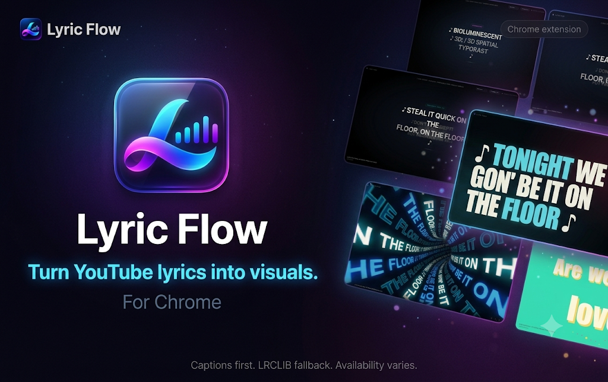
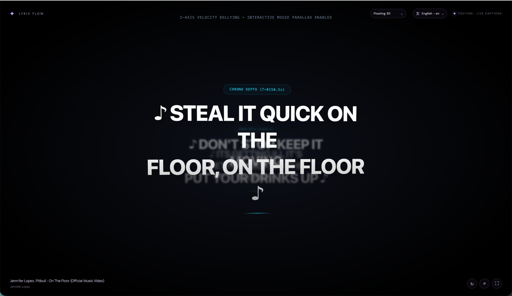
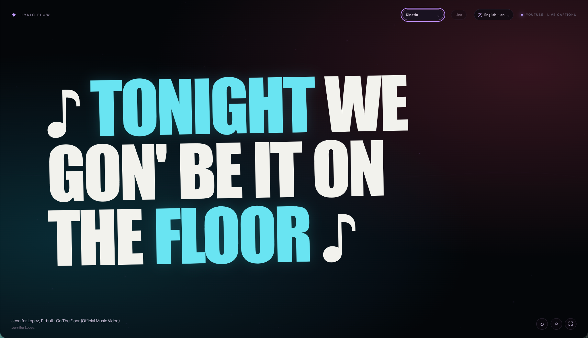
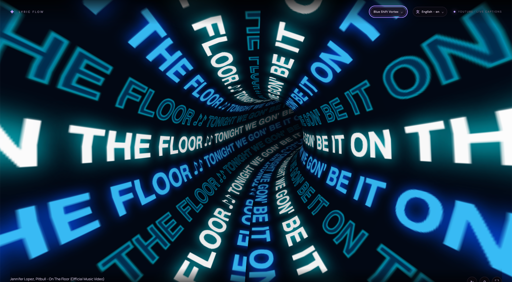
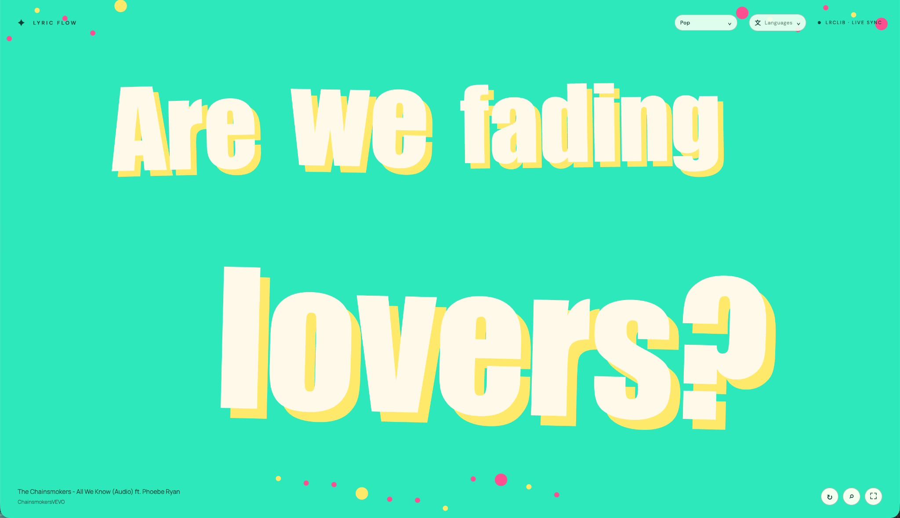
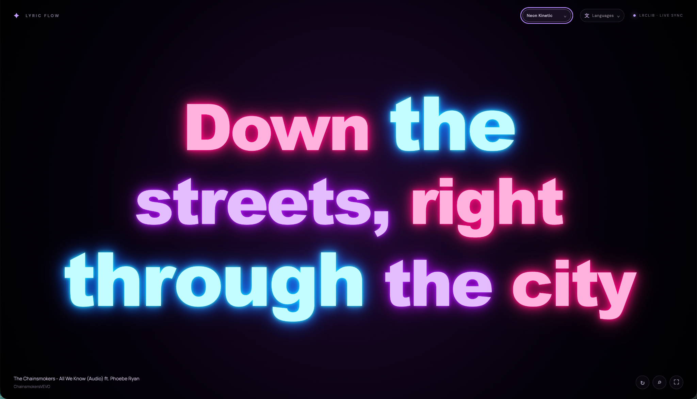

# ✨ Lyric Flow

### Turn YouTube lyrics into visuals.

**An immersive, animated lyrics visualizer for YouTube.**

[Watch the demo](https://youtu.be/QwmLDboIN_A?si=UASwtYlK7zLTzagY) ·
[Chrome Web Store](#) ·
[Privacy Policy](https://grtsahil.github.io/lyric-flow/privacy-policy)

---

## 🎧 What is Lyric Flow?

Lyric Flow transforms song lyrics into a living visual experience. Instead of reading static subtitles, watch words move, expand, glow and flow across your screen in sync with the music.

Built for music lovers who want to *see* the feeling behind the song.

## ✨ Features

- **Synchronized lyrics** — lyrics follow the video's playback position.
- **YouTube captions first** — uses available YouTube caption data as the primary source.
- **LRCLIB fallback** — looks for synchronized lyrics when usable YouTube captions aren't available.
- **Expressive visualizers** — switch between distinct animated typography experiences.
- **Language selection** — choose from available caption tracks when supported.
- **Immersive viewing** — a clean, distraction-free visualizer with playback-aware controls.

> Caption availability depends on the video, language and captions provided by YouTube. LRCLIB fallback availability also varies by song.

## 🌈 Visualizer styles

| Style | Experience |
|---|---|
| **Floating 3D** | Lyrics move through a spatial, depth-filled scene. |
| **Kinetic** | Bold typography scales and shifts with the song. |
| **Blue Shift Vortex** | Repeating lyrics spiral through a vivid blue tunnel. |
| **Pop** | Bright, playful typography with energetic colors. |
| **Neon Kinetic** | Glowing words in a vibrant neon palette. |

## 👀 Preview

### Floating 3D

### Kinetic typography

### Blue Shift Vortex

### Pop

### Neon Kinetic

## 🚀 Getting started

1. Install **Lyric Flow** from the Chrome Web Store (once the listing is published).
2. Open a YouTube music video in Chrome.
3. Open Lyric Flow.
4. Choose an available language and visualizer style.
5. Enjoy lyrics that move with the music.

## 🎬 Watch Lyric Flow in action

## 🔐 Privacy

Lyric Flow uses YouTube caption information to synchronize lyrics with video playback and may query LRCLIB when a fallback is needed. For details about information processed, local storage and third-party requests, read the project's [Privacy Policy](#).

## ⚠️ Availability

- Lyrics depend on caption availability and the supported language tracks for each video.
- LRCLIB may not have a matching synchronized lyric file for every song.
- Timing and lyric accuracy can vary depending on the source.

## 💜 The idea

Music is more than sound. Lyric Flow gives the words their own visual rhythm.

**Feel the lyrics. See the music. Live the flow.**
